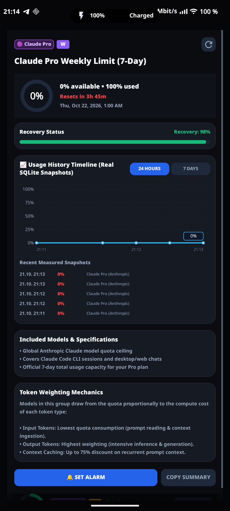
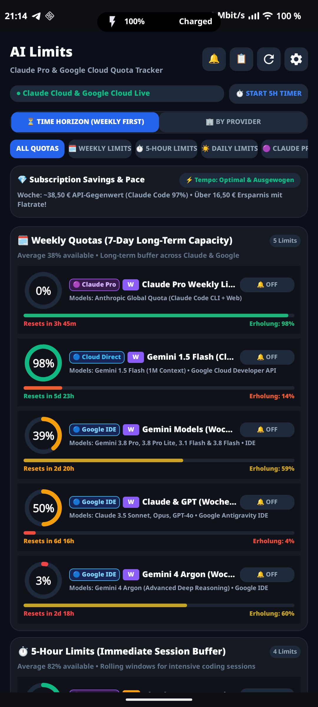

# AI Limits ⚡ Android AI Quota & Reset Tracker

[-3DDC84?logo=android&logoColor=white)](#)
[](#)
[-success)](#)
[](#)
[](#)
[](#)

A fast, lightweight, and completely private native Android application for tracking AI quota limits, rolling resets, and token consumption across **Claude Pro (Anthropic)**, **Google Cloud Developer API (Gemini 1.5 Pro / Flash)**, and **Google Antigravity IDE Models (Gemini 3.8, Gemini 4 Argon, Claude 3.5 & GPT-4o proxy)**.

Built with **zero external dependencies** and pure native Java/Canvas rendering, producing an ultra-compact ~86 KB APK with zero background battery drain.

---

## 📸 Screenshots

| Time Horizon (Weekly First) | Interactive Detail & SQLite History | Multi-Language & Multi-Theme | Provider Grouped View |
|:---:|:---:|:---:|:---:|
|  |  |  |  |

---

## 🌟 Key Features

### 1. ⏳ Dual-View Architecture: Time-Horizon vs. Provider
* **Time-Horizon View (Weekly Quotas First):** Aggregates all long-term weekly quotas across providers (Claude Pro 7-Day, Gemini 1.5 Flash, Gemini Pro, Argon) at the top so you always know your total remaining weekly capacity at a glance, followed by immediate 5-hour rolling working windows and daily midnight developer quotas.
* **By Provider View:** Classic grouped view categorizing limits by provider cards (Claude Pro, Google Cloud, Antigravity IDE Models).

### 2. 📊 Interactive Deep-Dive Inspection on Tile Tap
Tap any quota tile to open an instant deep-dive modal featuring:
* **Circular Progress Ring & Precise Metrics:** Immediate percentage of available vs. consumed capacity.
* **Exact Local Reset Timestamps:** Automatically calculates and displays the exact local date and time of full quota restoration (e.g. *Thu, Oct 22, 2026, 1:00 AM*) in addition to relative countdown timers.
* **Included Models Breakdown:** Exact specifications, context windows (up to 2 Million tokens), and architectural roles for each model in the bucket.
* **Token Weighting Mechanics:** Explains how input tokens, output tokens (highest cost tier), and cached prompt contexts (up to 75% discount) scale against the shared pool.

### 3. 📈 Genuine SQLite Historical Timeline (24h & 7d)
* Custom Canvas-based Bézier curve plotting historical quota usage over time.
* **100% Authentic Data:** Backed by an on-device SQLite database (`ai_limits_history.db`). Only records real, genuine snapshots measured during API refreshes—**zero synthetic interpolations or fake past data**.
* Toggle seamlessly between a **24-Hour** detailed view and a **7-Day** weekly trend with recent measurement logs.

### 4. 🌍 Full Multi-Language Localization
Switch entire app strings instantly inside Settings between:
* 🇬🇧 **English** (Default)
* 🇩🇪 **Deutsch** (German)
* 🇫🇷 **Français** (French)

All headers, cards, status badges, model explanations, dialogs, and date/time formats adapt immediately on the fly without restarting.

### 5. 🎨 Multi-Theme Visual Engine
Choose from 4 custom-crafted visual themes designed for AMOLED/OLED battery savings and high aesthetic appeal:
* 🌌 **Cyberpunk Dark:** Deep slate `#0B0F19` background with neon cyan and violet accents.
* 🖤 **OLED Pure Black:** True `#000000` pixel-off black mode for maximum battery life on AMOLED screens (e.g., Volla Phone).
* 🌊 **Deep Ocean Navy:** Midnight navy `#0A192F` with seafoam and aquamarine accents.
* 🌲 **Emerald Matrix:** Forest dark `#0A1A14` with vivid emerald green highlights.

### 6. 🌐 100% Standalone Cloud-Direct Sync (No PC Required)
* **Claude Pro Cloud Direct:** Connects directly via OAuth to Anthropic (`api.anthropic.com/api/oauth/usage`) to fetch 5-hour limits, 7-day limits, and usage breakdowns.
* **Google Cloud Direct:** Connects directly to Google OAuth (`oauth2.googleapis.com`) with user profile verification (`googleapis.com/oauth2/v3/userinfo`) and Cloud Resource Manager project inspection (`cloudresourcemanager.googleapis.com/v1/projects`).
* **Desktop Bridge (Optional):** Supports connecting to local Antigravity Language Server sessions when on your local network.

### 7. 🔔 Message Center & Smart Digest Notifications
* **Individual Alerts:** Instant notification when a specific model restores to 100% or drops below a warning threshold.
* **AI Digest Mode:** Bundles all tracked models into a single consolidated summary notification on a customizable cadence (1h, 2h, 4h, or daily).
* **Early Warning Threshold:** Get alerted when quota drops below 15% to plan workflow pauses before hitting hard rate limits.
* **Do Not Disturb (Quiet Hours):** Mutes notifications automatically between 23:00 and 07:00.

### 8. 📱 Home Screen Live Widget
* Native Android `AppWidgetProvider` for launcher integration.
* Displays live percentages and countdown timers for Claude Pro and Google Cloud without opening the app.

---

## 🏛️ Quota Architecture Explained

| Quota Category | Source & Authentication | Models Included | Reset Cycle |
|:---|:---|:---|:---|
| **Claude Pro (Anthropic)** | Anthropic Web OAuth Token | Claude 3.5 Sonnet, Claude 3 Opus, Claude 3.5 Haiku | 5-Hour rolling window & 7-Day weekly ceiling |
| **Google Cloud Direct** | GCP Console OAuth Project (`gen-lang-client-...`) | Gemini 1.5 Pro (2M context), Gemini 1.5 Flash (1M context) | Requests Per Day (RPD / Midnight UTC) & RPM |
| **Google IDE Models** | Google Antigravity Language Server | Gemini 3.8 Pro, Flash, Pro Lite, Gemini 4 Argon, Claude 3.5 & GPT-4o proxy | Rolling session windows & weekly IDE allowances |

---

## 🔒 Privacy & Security

* **Zero telemetry, zero analytics, zero external trackers.**
* All OAuth tokens, refresh tokens, and CSRF credentials are stored strictly in private app storage.
* Network requests only communicate directly with the official endpoints (`api.anthropic.com`, `oauth2.googleapis.com`, and `googleapis.com`).
* Build configurations automatically exclude credential files via `.gitignore`.

---

## 🛠️ Building & Installation

The project uses a pure, ultra-fast toolchain script (`build.sh`) without heavy Gradle daemons, building and signing an ~86 KB APK in under 5 seconds.

### Prerequisites
* JDK 11 or newer (`javac`)
* Android SDK build-tools (version 30+)
* Android platform JAR (`android-34` recommended)

### Build
```bash
# Clone the repository
git clone https://github.com/diggaknoxville/ai-limits.git
cd ai-limits

# Build and sign the APK
./build.sh
```
The compiled APK will be created at `build/ai-limits.apk`.

### Install via ADB
```bash
adb install -r build/ai-limits.apk
```

---

## ⚙️ Configuration

Credentials can be entered in the in-app **Settings** (⚙️) dialog:
1. Tap the **Settings** icon in the top header.
2. Enter your **Claude Refresh Token** (`sk-ant-ort01-...`).
3. Enter your **Google Refresh Token** (`1//033...`).
4. Select your preferred **Language** and **Theme**.
5. Tap **Verify Claude Cloud** or **Verify Google Cloud** to test your connection live.
6. Tap **Save Settings**.

---

## 📄 License

Distributed under the MIT License. See [LICENSE](LICENSE) for details.
